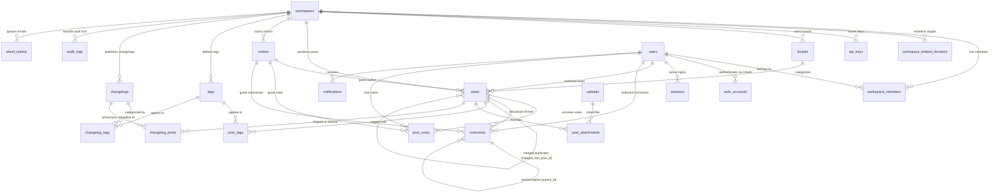

# FeedbackPulse: Complete Database Architecture Reference

> **Comprehensive Technical Guide: 24 Tables · 14 Enums · Indexes · 10 Functions · 19 Triggers**  
> *Designed for PostgreSQL 16+ with Drizzle ORM and strict `snake_case` conventions.*

---

## Table of Contents
1. [Architectural Overview & Visual ER Diagram](#1-architectural-overview--visual-er-diagram)
2. [Complete 24-Table Reference](#2-complete-24-table-reference)
   - [Cluster 1: Identity & Authentication (4 Tables)](#cluster-1-identity--authentication-4-tables)
   - [Cluster 2: Tenancy & Governance (4 Tables)](#cluster-2-tenancy--governance-4-tables)
   - [Cluster 3: Feedback Core (5 Tables)](#cluster-3-feedback-core-5-tables)
   - [Cluster 4: Feedback Links & Assets (4 Tables)](#cluster-4-feedback-links--assets-4-tables)
   - [Cluster 5: Content & Releases (3 Tables)](#cluster-5-content--releases-3-tables)
   - [Cluster 6: Operations & Reliability (4 Tables)](#cluster-6-operations--reliability-4-tables)
3. [Index Architecture & Query Optimization](#3-index-architecture--query-optimization)
   - [Partial Unique Indexes](#partial-unique-indexes)
   - [Performance Composite Indexes](#performance-composite-indexes)
   - [Full-Text Search (GIN Index)](#full-text-search-gin-index)
4. [Stored Functions Reference (10 PL/pgSQL Functions)](#4-stored-functions-reference-10-plpgsql-functions)
5. [Database Triggers Reference (19 Triggers)](#5-database-triggers-reference-19-triggers)
6. [Database Enums Reference (14 Enums)](#6-database-enums-reference-14-enums)

---

## 1. Architectural Overview & Visual ER Diagram



---

## 2. Complete 24-Table Reference

### Cluster 1: Identity & Authentication (4 Tables)

#### 1. `users`
* **Purpose:** Stores core registered accounts (staff, workspace owners, administrators, and authenticated end-users).
* **Columns:**
  * `id` (`uuid`, PK, `defaultRandom()`): Unique user ID.
  * `email` (`varchar(255)`, Unique, Not Null): Primary contact and login email.
  * `name` (`varchar(255)`): Display name.
  * `avatar_url` (`text`): Profile image URL.
  * `password_hash` (`text`): Argon2id / Bcrypt password hash (null for OAuth-only users).
  * `status` (`user_status`, default `'ACTIVE'`): Account state (`ACTIVE`, `INVITED`, `SUSPENDED`).
  * `email_verified_at` (`timestamptz`): Email confirmation timestamp.
  * `settings` (`jsonb`, default `{}`): User preferences (locale, theme, notifications).
  * `deleted_at` (`timestamptz`): Soft-delete marker.
  * `created_at`, `updated_at` (`timestamptz`, Not Null): Audit timestamps.

#### 2. `auth_accounts`
* **Purpose:** Enables federated Single Sign-On / OAuth (Google, GitHub, SAML SSO).
* **Columns:**
  * `id` (`uuid`, PK): Account link identifier.
  * `user_id` (`uuid`, FK $\to$ `users.id` on delete cascade): Parent user account.
  * `provider` (`auth_provider`): Identity provider (`GOOGLE`, `GITHUB`, `EMAIL`, `SAML`).
  * `provider_account_id` (`varchar(255)`): Provider-scoped subject/account ID.
  * `access_token`, `refresh_token` (`text`): Encrypted OAuth tokens.
  * `expires_at` (`timestamptz`): Token expiration date.
  * `created_at` (`timestamptz`).
* **Constraints:** Unique on `(provider, provider_account_id)`.

#### 3. `sessions`
* **Purpose:** Stateful session tracking supporting instant device logout and token revocation.
* **Columns:**
  * `id` (`uuid`, PK): Session identifier.
  * `user_id` (`uuid`, FK $\to$ `users.id` on delete cascade).
  * `token_hash` (`varchar(255)`, Unique): SHA-256 hash of the bearer session token.
  * `expires_at` (`timestamptz`, Not Null): Sliding expiration threshold.
  * `revoked_at` (`timestamptz`): Populated when session is manually terminated.
  * `ip_address` (`varchar(45)`), `user_agent` (`text`): Device fingerprinting.
  * `created_at` (`timestamptz`).

#### 4. `one_time_tokens`
* **Purpose:** Secure, single-use authentication codes (Magic Links, Password Resets, Workspace Invites).
* **Columns:**
  * `id` (`uuid`, PK).
  * `user_id` (`uuid`, FK $\to$ `users.id` on delete cascade, Nullable for new invitees).
  * `email` (`varchar(255)`, Not Null): Target recipient.
  * `purpose` (`token_purpose`): `EMAIL_VERIFICATION`, `PASSWORD_RESET`, `MAGIC_LINK`, `WORKSPACE_INVITE`.
  * `token_hash` (`varchar(255)`, Unique): Hashed consumable secret.
  * `expires_at` (`timestamptz`, Not Null): Short-lived expiry (typically 15–60 mins).
  * `created_at` (`timestamptz`).

---

### Cluster 2: Tenancy & Governance (4 Tables)

#### 5. `workspaces`
* **Purpose:** The root multi-tenant entity. Every customer organization operates inside a isolated workspace.
* **Columns:**
  * `id` (`uuid`, PK): Tenant primary key referenced by all business tables.
  * `name` (`varchar(255)`, Not Null): Company / product name.
  * `slug` (`varchar(100)`, Unique, Not Null): Vanity URL identifier (`/b/:slug`).
  * `logo_url` (`text`): Workspace avatar/logo.
  * `primary_color` (`varchar(30)`, default `'#4F46E5'`): Custom accent branding color.
  * `plan` (`workspace_plan`, default `'FREE'`): Billing tier (`FREE`, `PRO`, `ENTERPRISE`).
  * `settings` (`jsonb`): Tenant configuration (custom domain, moderation toggles).
  * `deleted_at` (`timestamptz`): Soft-delete flag.
  * `created_at`, `updated_at` (`timestamptz`).

#### 6. `workspace_members`
* **Purpose:** Join table managing team permissions and roles within a workspace.
* **Columns:**
  * `id` (`uuid`, PK).
  * `workspace_id` (`uuid`, FK $\to$ `workspaces.id` on delete cascade).
  * `user_id` (`uuid`, FK $\to$ `users.id` on delete cascade).
  * `role` (`workspace_member_role`, default `'MEMBER'`): `OWNER`, `ADMIN`, `MEMBER`.
  * `status` (`workspace_member_status`, default `'ACTIVE'`): `ACTIVE`, `INVITED`, `SUSPENDED`.
  * `created_at`, `updated_at` (`timestamptz`).
* **Constraints:** Unique on `(workspace_id, user_id)`.

#### 7. `workspace_embed_domains`
* **Purpose:** **Security perimeter for the embeddable `widget.js` script.** Whitelists external customer websites permitted to host the widget.
* **Columns:**
  * `id` (`uuid`, PK).
  * `workspace_id` (`uuid`, FK $\to$ `workspaces.id` on delete cascade).
  * `origin` (`varchar(255)`, Not Null): Allowed origin (e.g. `https://app.customer.com`).
  * `is_verified` (`boolean`, default `false`): Verification status (via DNS or meta tag).
  * `created_at` (`timestamptz`).
* **Constraints:** Unique on `(workspace_id, origin)`.

#### 8. `api_keys`
* **Purpose:** Programmatic API access for workspace automations (Slack bot, Zapier, Linear sync).
* **Columns:**
  * `id` (`uuid`, PK).
  * `workspace_id` (`uuid`, FK $\to$ `workspaces.id` on delete cascade).
  * `name` (`varchar(255)`, Not Null): Friendly label (e.g. "Zapier Pipeline").
  * `key_hash` (`varchar(255)`, Unique, Not Null): SHA-256 hash of API key.
  * `scopes` (`jsonb`, default `'["read","write"]'`): Array of permitted scopes.
  * `last_used_at`, `revoked_at` (`timestamptz`).
  * `created_at` (`timestamptz`).

---

### Cluster 3: Feedback Core (5 Tables)

#### 9. `visitors`
* **Purpose:** Tracks anonymous/guest end-users on public feedback boards and embedded widgets. Enables instant voting and commenting without requiring a full account.
* **Columns:**
  * `id` (`uuid`, PK).
  * `workspace_id` (`uuid`, FK $\to$ `workspaces.id` on delete cascade).
  * `anonymous_id` (`varchar(100)`, Not Null): Client-side device cookie/UUID.
  * `name`, `email` (`varchar(255)`): Optional details if guest provides them.
  * `ip_hash` (`varchar(100)`): Anonymized cryptographic hash of IP for fraud/rate prevention.
  * `last_seen_at` (`timestamptz`, default `NOW()`).
  * `created_at` (`timestamptz`).
* **Constraints:** Unique on `(workspace_id, anonymous_id)`.

#### 10. `boards`
* **Purpose:** Organizes feedback into discrete channels (e.g. "Feature Requests", "Bug Reports", "Mobile App Ideas").
* **Columns:**
  * `id` (`uuid`, PK).
  * `workspace_id` (`uuid`, FK $\to$ `workspaces.id` on delete cascade).
  * `name` (`varchar(255)`, Not Null): Board name.
  * `slug` (`varchar(100)`, Not Null): URL slug (e.g. `features`).
  * `description` (`text`): Description shown in header.
  * `is_default` (`boolean`, default `false`): Landing board for workspace.
  * `is_public` (`boolean`, default `true`): Public vs. internal-only board.
  * `archived_at` (`timestamptz`).
  * `created_at` (`timestamptz`).
* **Constraints:** Unique on `(workspace_id, slug)`.

#### 11. `posts`
* **Purpose:** The central feedback item. Represents a customer suggestion, bug report, or feature request.
* **Columns:**
  * `id` (`uuid`, PK).
  * `workspace_id` (`uuid`, FK $\to$ `workspaces.id` on delete cascade): Multi-tenant partitioning key.
  * `board_id` (`uuid`, FK $\to$ `boards.id` on delete cascade).
  * `author_user_id` (`uuid`, FK $\to$ `users.id` on delete set null): If created by registered user.
  * `author_visitor_id` (`uuid`, FK $\to$ `visitors.id` on delete set null): If created by anonymous guest.
  * `title` (`varchar(255)`, Not Null).
  * `content` (`text`, Not Null): Markdown body.
  * `status` (`post_status`, default `'UNDER_REVIEW'`): `UNDER_REVIEW`, `PLANNED`, `IN_PROGRESS`, `COMPLETED`, `CLOSED`.
  * `moderation_status` (`moderation_status`, default `'APPROVED'`): `PENDING`, `APPROVED`, `REJECTED`, `FLAGGED`.
  * `vote_count` (`integer`, default `0`, Not Null): **Managed exclusively by database trigger.**
  * `comment_count` (`integer`, default `0`, Not Null): **Managed exclusively by database trigger.**
  * `search_vector` (`tsvector`, Generated): Auto-computed English text search index.
  * `merged_into_post_id` (`uuid`, FK $\to$ `posts.id` on delete set null): Target post if merged as duplicate.
  * `deleted_at` (`timestamptz`): Soft-delete marker.
  * `created_at`, `updated_at` (`timestamptz`).

#### 12. `post_votes`
* **Purpose:** Records community votes. Supports both registered users and anonymous visitors.
* **Columns:**
  * `id` (`uuid`, PK).
  * `workspace_id` (`uuid`, FK $\to$ `workspaces.id` on delete cascade).
  * `post_id` (`uuid`, FK $\to$ `posts.id` on delete cascade).
  * `user_id` (`uuid`, FK $\to$ `users.id` on delete cascade, Nullable).
  * `visitor_id` (`uuid`, FK $\to$ `visitors.id` on delete cascade, Nullable).
  * `created_at` (`timestamptz`).
* **Constraints:** Partial unique indexes preventing double-voting (`post_id`, `user_id`) and (`post_id`, `visitor_id`).

#### 13. `comments`
* **Purpose:** Discussion thread on feedback items. Supports hierarchical nesting and admin-only internal notes.
* **Columns:**
  * `id` (`uuid`, PK).
  * `workspace_id` (`uuid`, FK $\to$ `workspaces.id` on delete cascade).
  * `post_id` (`uuid`, FK $\to$ `posts.id` on delete cascade).
  * `parent_id` (`uuid`, FK $\to$ `comments.id` on delete cascade, Nullable): Enables nested replies.
  * `author_user_id` (`uuid`, FK $\to$ `users.id` on delete set null).
  * `author_visitor_id` (`uuid`, FK $\to$ `visitors.id` on delete set null).
  * `content` (`text`, Not Null): Markdown message body.
  * `is_internal` (`boolean`, default `false`, Not Null): **Admin internal note.** Strictly filtered out from public board API.
  * `moderation_status` (`moderation_status`, default `'APPROVED'`).
  * `deleted_at` (`timestamptz`): Soft-delete marker.
  * `created_at`, `updated_at` (`timestamptz`).

---

### Cluster 4: Feedback Links & Assets (4 Tables)

#### 14. `tags`
* **Purpose:** Taxonomy tags with color badges (e.g. `Integration`, `Mobile`, `Billing`).
* **Columns:**
  * `id` (`uuid`, PK).
  * `workspace_id` (`uuid`, FK $\to$ `workspaces.id` on delete cascade).
  * `name` (`varchar(100)`, Not Null), `slug` (`varchar(100)`, Not Null).
  * `color` (`varchar(30)`, default `'#6B7280'`): Hex color token.
  * `created_at` (`timestamptz`).
* **Constraints:** Unique on `(workspace_id, slug)`.

#### 15. `post_tags`
* **Purpose:** Many-to-many junction applying tags to feedback posts.
* **Columns:**
  * `post_id` (`uuid`, FK $\to$ `posts.id` on delete cascade).
  * `tag_id` (`uuid`, FK $\to$ `tags.id` on delete cascade).
* **Constraints:** Primary Key on `(post_id, tag_id)`.

#### 16. `uploads`
* **Purpose:** Metadata for files, screenshots, and logs uploaded to S3 / Cloudflare R2.
* **Columns:**
  * `id` (`uuid`, PK).
  * `workspace_id` (`uuid`, FK $\to$ `workspaces.id` on delete cascade).
  * `uploader_user_id` (`uuid`, FK $\to$ `users.id` on delete set null).
  * `file_name` (`varchar(255)`, Not Null): Original filename.
  * `storage_key` (`varchar(500)`, Unique, Not Null): Bucket storage path / key.
  * `content_type` (`varchar(100)`, Not Null): MIME type (e.g. `image/png`).
  * `size_bytes` (`integer`, Not Null): File size.
  * `created_at` (`timestamptz`).

#### 17. `post_attachments`
* **Purpose:** Junction attaching uploaded files/images to specific feedback items.
* **Columns:**
  * `post_id` (`uuid`, FK $\to$ `posts.id` on delete cascade).
  * `upload_id` (`uuid`, FK $\to$ `uploads.id` on delete cascade).
* **Constraints:** Primary Key on `(post_id, upload_id)`.

---

### Cluster 5: Content & Releases (3 Tables)

#### 18. `changelogs`
* **Purpose:** Product release notes CMS. Publishes version announcements to public boards and widget drawer.
* **Columns:**
  * `id` (`uuid`, PK).
  * `workspace_id` (`uuid`, FK $\to$ `workspaces.id` on delete cascade).
  * `title` (`varchar(255)`, Not Null): e.g. "v1.2 Release: Dark Mode & Zapier".
  * `slug` (`varchar(150)`, Not Null): Release URL slug (`/changelog/:slug`).
  * `content` (`text`, Not Null): Rich markdown release notes.
  * `status` (`changelog_status`, default `'DRAFT'`): `DRAFT`, `SCHEDULED`, `PUBLISHED`, `ARCHIVED`.
  * `published_at` (`timestamptz`): Live publication time.
  * `scheduled_for` (`timestamptz`): Scheduled publication trigger time.
  * `author_user_id` (`uuid`, FK $\to$ `users.id` on delete set null).
  * `created_at`, `updated_at` (`timestamptz`).
* **Constraints:** Unique on `(workspace_id, slug)`.

#### 19. `changelog_tags`
* **Purpose:** Junction applying category pills to release notes (`New Feature`, `Improvement`, `Bug Fix`).
* **Columns:**
  * `changelog_id` (`uuid`, FK $\to$ `changelogs.id` on delete cascade).
  * `tag_id` (`uuid`, FK $\to$ `tags.id` on delete cascade).
* **Constraints:** Primary Key on `(changelog_id, tag_id)`.

#### 20. `changelog_posts`
* **Purpose:** **Closes the feedback loop.** Links published release notes directly to the feedback posts they resolved. Triggers automated emails to everyone who voted on the feature.
* **Columns:**
  * `changelog_id` (`uuid`, FK $\to$ `changelogs.id` on delete cascade).
  * `post_id` (`uuid`, FK $\to$ `posts.id` on delete cascade).
* **Constraints:** Primary Key on `(changelog_id, post_id)`.

---

### Cluster 6: Operations & Reliability (4 Tables)

#### 21. `audit_logs`
* **Purpose:** Immutable compliance audit trail tracking all administrative actions.
* **Columns:**
  * `id` (`uuid`, PK).
  * `workspace_id` (`uuid`, FK $\to$ `workspaces.id` on delete cascade).
  * `actor_user_id` (`uuid`, FK $\to$ `users.id` on delete set null).
  * `action` (`varchar(100)`, Not Null): e.g. `POST_STATUS_CHANGED`, `MEMBER_REMOVED`.
  * `entity_type` (`varchar(50)`, Not Null): Target table (e.g. `post`, `workspace_member`).
  * `entity_id` (`uuid`, Not Null): Target record ID.
  * `metadata` (`jsonb`, default `{}`): Snapshot of old vs. new state.
  * `ip_address` (`varchar(45)`): Request IP.
  * `created_at` (`timestamptz`).

#### 22. `notifications`
* **Purpose:** User notifications for status changes, new comments, and release updates.
* **Columns:**
  * `id` (`uuid`, PK).
  * `user_id` (`uuid`, FK $\to$ `users.id` on delete cascade).
  * `workspace_id` (`uuid`, FK $\to$ `workspaces.id` on delete cascade).
  * `kind` (`notification_kind`): `POST_STATUS_CHANGED`, `NEW_COMMENT`, `COMMENT_REPLY`, etc.
  * `title` (`varchar(255)`, Not Null), `body` (`text`).
  * `entity_type` (`varchar(50)`), `entity_id` (`uuid`).
  * `read_at` (`timestamptz`): Null when unread; set upon opening.
  * `created_at` (`timestamptz`).

#### 23. `notification_preferences`
* **Purpose:** User-level subscription toggles per alert category.
* **Columns:**
  * `user_id` (`uuid`, FK $\to$ `users.id` on delete cascade).
  * `kind` (`notification_kind`): The notification type.
  * `email_enabled` (`boolean`, default `true`).
  * `in_app_enabled` (`boolean`, default `true`).
* **Constraints:** Primary Key on `(user_id, kind)`.

#### 24. `email_outbox`
* **Purpose:** **Transactional Outbox Pattern.** Ensures emails are sent reliably without slowing down user HTTP requests or dropping emails if Resend times out.
* **Columns:**
  * `id` (`uuid`, PK).
  * `workspace_id` (`uuid`, FK $\to$ `workspaces.id` on delete cascade).
  * `to_email` (`varchar(255)`, Not Null).
  * `template` (`varchar(100)`, Not Null): Template ID (e.g. `feature_shipped`, `new_comment`).
  * `payload` (`jsonb`, default `{}`): Template template variables.
  * `dedupe_key` (`varchar(255)`, Unique): Prevents sending duplicate emails on retries.
  * `status` (`email_status`, default `'PENDING'`): `PENDING`, `SENDING`, `SENT`, `FAILED`.
  * `scheduled_for`, `sent_at` (`timestamptz`).
  * `attempts` (`integer`, default `0`), `last_error` (`text`).
  * `created_at` (`timestamptz`).

---

## 3. Index Architecture & Query Optimization

Indexes are crafted to ensure sub-10ms response times on high-traffic public boards:

### Partial Unique Indexes
* **`post_votes_post_user_unique_idx`:**
  ```sql
  CREATE UNIQUE INDEX post_votes_post_user_unique_idx 
      ON post_votes (post_id, user_id) 
   WHERE user_id IS NOT NULL;
  ```
  *Why:* Guarantees a registered user can vote on a post at most once, while ignoring rows where `user_id` is NULL.
* **`post_votes_post_visitor_unique_idx`:**
  ```sql
  CREATE UNIQUE INDEX post_votes_post_visitor_unique_idx 
      ON post_votes (post_id, visitor_id) 
   WHERE visitor_id IS NOT NULL;
  ```
  *Why:* Guarantees an anonymous visitor can vote at most once per post.

### Performance Composite Indexes
* **`posts_board_feed_idx` on `posts (board_id, status, vote_count)`:**
  *Why:* Powers the primary public feedback board view. Allows PostgreSQL to filter by board, filter by status, and sort by top votes in a single index scan without reading the table heap.
* **`posts_workspace_status_idx` on `posts (workspace_id, status)`:**
  *Why:* Powers the 3-column public Roadmap view (`PLANNED`, `IN_PROGRESS`, `COMPLETED`).
* **`email_outbox_status_scheduled_idx` on `email_outbox (status, scheduled_for)`:**
  *Why:* Enables background workers to fetch pending emails (`WHERE status = 'PENDING' AND scheduled_for <= NOW()`) instantly without table scans.
* **`notifications_user_read_idx` on `notifications (user_id, read_at)`:**
  *Why:* Powers the unread notification badge count (`WHERE user_id = $1 AND read_at IS NULL`).

### Full-Text Search (GIN Index)
* **`posts.search_vector`:**
  ```sql
  search_vector tsvector GENERATED ALWAYS AS (
    to_tsvector('english', coalesce(title, '') || ' ' || coalesce(content, ''))
  ) STORED;
  ```
  *Why:* As users type a new suggestion, a `WHERE search_vector @@ plainto_tsquery('english', $1)` query returns matching suggestions in under 2ms to prevent duplicate post submissions.

---

## 4. Stored Functions Reference (10 PL/pgSQL Functions)

All trigger functions are implemented in [`post_migrate.sql`](file:///c:/FeedbackPulse/apps/api/src/db/sql/post_migrate.sql) and are 100% idempotent:

| Function Name | Purpose |
| :--- | :--- |
| **`fp_set_updated_at()`** | Automatically sets `NEW.updated_at = NOW()` on row updates for tables with timestamp tracking. |
| **`fp_sync_post_vote_count()`** | Increments `posts.vote_count` on `post_votes` INSERT; decrements on DELETE. Ensures vote counts never drift. |
| **`fp_sync_post_comment_count()`** | Increments/decrements `posts.comment_count`. **Crucial invariant:** strictly ignores `is_internal = true` (internal notes) and soft-deleted comments. |
| **`fp_guard_post_workspace()`** | **Cross-Tenant Integrity Guard:** Verifies that a post's `workspace_id` matches its parent board's `workspace_id`. Rejects unauthorized cross-tenant writes. |
| **`fp_guard_comment_workspace()`** | Verifies comment `workspace_id` matches post `workspace_id`. |
| **`fp_guard_vote_workspace()`** | Verifies vote `workspace_id` matches post `workspace_id`. |
| **`fp_guard_vote_active_post()`** | Throws an exception if a user attempts to vote on a soft-deleted post. |
| **`fp_touch_post_activity()`** | Bumps `posts.updated_at` whenever a new comment, vote, or attachment is added to keep active threads at the top of the feed. |
| **`fp_touch_workspace_updated_at()`** | Bumps `workspaces.updated_at` when child boards or tags are added or reconfigured. |
| **`fp_sync_token_email()`** | Automatically populates `one_time_tokens.email` from `users.email` if only `user_id` was supplied. |

---

## 5. Database Triggers Reference (19 Triggers)

The 19 triggers enforce security, automated counters, and audit timestamps natively inside the PostgreSQL database engine:

| Trigger Name | Target Table | Timing & Event | Attached Function |
| :--- | :--- | :--- | :--- |
| `trg_users_updated_at` | `users` | BEFORE UPDATE | `fp_set_updated_at()` |
| `trg_workspaces_updated_at` | `workspaces` | BEFORE UPDATE | `fp_set_updated_at()` |
| `trg_workspace_members_updated_at` | `workspace_members` | BEFORE UPDATE | `fp_set_updated_at()` |
| `trg_posts_updated_at` | `posts` | BEFORE UPDATE | `fp_set_updated_at()` |
| `trg_comments_updated_at` | `comments` | BEFORE UPDATE | `fp_set_updated_at()` |
| `trg_changelogs_updated_at` | `changelogs` | BEFORE UPDATE | `fp_set_updated_at()` |
| `trg_post_votes_count` | `post_votes` | AFTER INSERT OR DELETE | `fp_sync_post_vote_count()` |
| `trg_comments_count` | `comments` | AFTER INSERT, UPDATE, DELETE | `fp_sync_post_comment_count()` |
| `trg_posts_workspace_guard` | `posts` | BEFORE INSERT OR UPDATE | `fp_guard_post_workspace()` |
| `trg_comments_workspace_guard` | `comments` | BEFORE INSERT OR UPDATE | `fp_guard_comment_workspace()` |
| `trg_post_votes_workspace_guard` | `post_votes` | BEFORE INSERT OR UPDATE | `fp_guard_vote_workspace()` |
| `trg_post_votes_active_guard` | `post_votes` | BEFORE INSERT | `fp_guard_vote_active_post()` |
| `trg_comments_touch_post` | `comments` | AFTER INSERT | `fp_touch_post_activity()` |
| `trg_post_votes_touch_activity` | `post_votes` | AFTER INSERT | `fp_touch_post_activity()` |
| `trg_changelog_posts_touch` | `changelog_posts`| AFTER INSERT | `fp_touch_post_activity()` |
| `trg_post_attachments_touch` | `post_attachments` | AFTER INSERT | `fp_touch_post_activity()` |
| `trg_one_time_tokens_email` | `one_time_tokens` | BEFORE INSERT | `fp_sync_token_email()` |
| `trg_boards_touch_workspace` | `boards` | AFTER INSERT OR UPDATE | `fp_touch_workspace_updated_at()` |
| `trg_tags_touch_workspace` | `tags` | AFTER INSERT OR UPDATE | `fp_touch_workspace_updated_at()` |

---

## 6. Database Enums Reference (14 Enums)

| Enum | Allowed Values | Usage / Scope |
| :--- | :--- | :--- |
| **`user_status`** | `ACTIVE`, `INVITED`, `SUSPENDED` | Account lifecycle state. |
| **`workspace_plan`** | `FREE`, `PRO`, `ENTERPRISE` | Tenant billing tier and feature gates. |
| **`workspace_member_role`** | `OWNER`, `ADMIN`, `MEMBER` | Role-based access control (RBAC). |
| **`workspace_member_status`** | `ACTIVE`, `INVITED`, `SUSPENDED` | Workspace team membership invitation status. |
| **`token_purpose`** | `EMAIL_VERIFICATION`, `PASSWORD_RESET`, `MAGIC_LINK`, `WORKSPACE_INVITE` | Single-use token security categorization. |
| **`post_status`** | `UNDER_REVIEW`, `PLANNED`, `IN_PROGRESS`, `COMPLETED`, `CLOSED` | Feedback lifecycle & Kanban roadmap columns. |
| **`moderation_status`** | `PENDING`, `APPROVED`, `REJECTED`, `FLAGGED` | Content moderation and spam guard filter. |
| **`changelog_status`** | `DRAFT`, `SCHEDULED`, `PUBLISHED`, `ARCHIVED` | Release notes publication workflow. |
| **`notification_kind`** | `POST_STATUS_CHANGED`, `NEW_COMMENT`, `COMMENT_REPLY`, `NEW_CHANGELOG`, `POST_MERGED` | Notification routing and event dispatch. |
| **`email_status`** | `PENDING`, `SENDING`, `SENT`, `FAILED` | Transactional outbox worker state machine. |
| **`audit_action`** | `WORKSPACE_CREATED`, `WORKSPACE_UPDATED`, `POST_STATUS_CHANGED`, `POST_MODERATED`, `POST_MERGED`, `POST_DELETED`, `COMMENT_DELETED`, `MEMBER_INVITED`, `MEMBER_ROLE_CHANGED`, `MEMBER_REMOVED`, `CHANGELOG_PUBLISHED`, `API_KEY_CREATED`, `API_KEY_REVOKED` | Comprehensive audit trail action logging. |
| **`auth_provider`** | `EMAIL`, `GOOGLE`, `GITHUB`, `SAML` | SSO and authentication provider identity. |
| **`tag_color`** | `GRAY`, `RED`, `ORANGE`, `AMBER`, `GREEN`, `TEAL`, `BLUE`, `INDIGO`, `PURPLE`, `PINK` | Normalized design system tag color tokens. |
| **`upload_kind`** | `IMAGE`, `DOCUMENT`, `AVATAR`, `LOGO` | File storage type categorization. |
